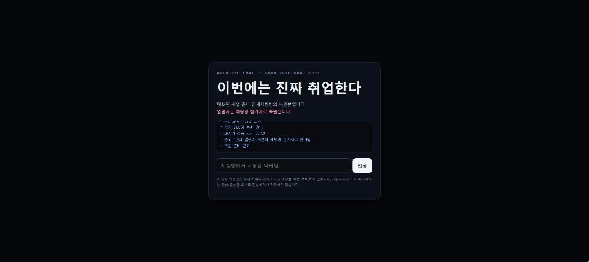
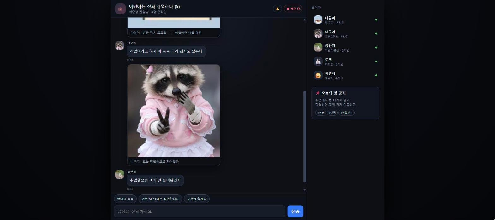

# 가족 같은 회사 v3 — 채용 기록

취업 준비생 단체 채팅방의 "복원 기록"을 열람하는 형식으로 진행되는 공포 연출 인터랙티브 웹 페이지입니다. 채팅 대화가 자동으로 재생되고, 사용자는 채팅방 참가자로서 답장을 고르고 영상 통화 · 화상 면접 장면을 거쳐 "가족 같은 회사"의 채용 절차를 끝까지 진행합니다.

- 바로 보기: https://develop-korea-tech.github.io/menhera/
- 형태: 단일 HTML 파일(이미지 내장) · 설치 없음 · PC/모바일 브라우저 지원
- 기술: HTML · CSS · JavaScript(외부 라이브러리 없음), 이미지는 WebP를 base64로 HTML 안에 내장
- 만든 시기: 2026-08 (마지막 업로드 기준)

> 화면 깜빡임 · 흔들림(글리치) 효과, 전체 화면 이미지 전환, 팝업 창이 연달아 뜨는 장면이 있습니다. 소리는 나지 않습니다.

| 입장 화면 — 닉네임 입력 | 단체 채팅방 — 대사 자동 재생과 답장 버튼 |
|---|---|
|  |  |

## 1. 주요 기능

- **채팅 자동 재생**: 대화 상대의 대사 58개가 "○○ 입력 중..." 표시(1.5초) 뒤 말풍선으로 나타나고, 3.5초 뒤 다음 대사로 넘어갑니다. 대화 상대는 참여자 4명(다람이 · 너구리 · 풍산개 · 토끼)과 도중에 입장하는 채용 담당자(여우)입니다.
- **닉네임 반영**: 입장할 때 입력한 닉네임(최대 10자, 비워 두면 `열람자`)이 대사, 참여자 목록, 엔딩의 사원증 화면에 들어갑니다.
- **답장 선택**: 채팅 중 세 번, 입력창 위에 나타나는 버튼으로 답장합니다. 어느 버튼을 골라도 같은 다음 장면으로 이어집니다(이야기 분기 없음). 세 번째 선택은 면접에서 카메라를 켤지 여부만 정합니다.
- **삭제 메시지 복원**: `메시지가 삭제되었습니다. · 눌러서 복원` 말풍선을 누르면 숨겨진 내용이 나타납니다.
- **프로필 변경 연출**: 참여자가 차례로 "회사"에 들어가면 사이드바의 소속 문구와 아바타가 바뀌고, 전체 화면 이미지 전환(1.7초)과 사진 메시지가 이어집니다.
- **전체 화면 장면**: 화면 공유, 영상 통화 수신 · 통화, 최종 화상 면접, 팝업, 사원증 엔딩이 채팅 화면 위에 차례로 열립니다(아래 장면 구성 참고).
- **카메라 미리보기(선택)**: 영상 통화 중 `📷` 버튼을 누르거나 면접에서 `카메라 켜고 참여`를 고르면 내 카메라 화면을 통화 화면의 작은 창이나 면접 화면의 내 칸에 보여 줍니다. 영상은 화면에만 표시되며, 외부로 보내거나 저장하는 코드는 없습니다.
- **탭 제목 알림**: 다른 탭을 보는 동안 새 대사가 오면 탭 제목이 `(개수) 이번에는 진짜 취업한다`로 바뀌고, 돌아오면 `새 메시지 N개` 알림이 뜹니다.

### 장면 구성

"자동 진행 시간"은 코드의 대기 시간(`sleep()`)을 합한 값이며, 사용자가 버튼을 누르기까지 걸리는 시간은 들어 있지 않습니다. 모두 합하면 약 6분입니다.

| 순서 | 장면 | 진행 방식 | 자동 진행 시간 | 내용 |
|---|---|---|---|---|
| 1 | 시작 화면 | 입력 | 약 2.3초 | 부팅 로그 6줄이 출력되면 닉네임을 입력하고 `입장`을 누릅니다 |
| 2 | 채팅 1 | 자동 → 선택 | 약 16초 | 대사 3개, 사진 2장 → 답장 3개 중 선택 |
| 3 | 채팅 2 | 자동 → 선택 | 약 3분 11초 | 대사 35개, 삭제 메시지, 채용 담당자 입장, 너구리 프로필 변경 → 답장 2개 중 선택 |
| 4 | 채팅 3 | 자동 | 약 51초 | 대사 9개, 토끼 소속 변경 |
| 5 | 화면 공유 | 자동 | 약 8초 | 브라우저 모양의 검색 결과 화면(사업자 등록 정보 · 법인 등기 "검색 결과 없음", 현재 재직자 3명 → 4명) |
| 6 | 영상 통화 수신 | 입력 | - | `📹`(받기) 또는 `✕`(거절). 거절을 두 번 누르면 그래도 연결됩니다 |
| 7 | 영상 통화 | 자동 | 약 10초 | 자막 5개와 통화 시간 표시 → `출근 확인 완료` 경고와 글리치 효과 → 통화 종료 |
| 8 | 채팅 4 | 자동 → 선택 | 약 59초 | 대사 10개, 다람이 프로필 변경 → `카메라 없이 참여` / `카메라 켜고 참여` 중 선택 |
| 9 | 최종 화상 면접 | 입력 | 문항 사이 합계 약 9초 | 6칸 화상 회의 화면, 객관식 3문항 → 자유 질문 1개 → 근로계약 동의 |
| 10 | 채팅 5 | 자동 | 약 10초 | 참여자 전원 퇴장, "가족 같은 회사" 입장, 사진 1장 |
| 11 | 팝업 | 자동 | 약 9.5초 | 팝업 창 20개가 점점 빠르게 뜨고, 창을 누르면 2개씩 늘어납니다. 끝나면 모두 자동으로 사라집니다 |
| 12 | 엔딩 | 입력 | - | 사원증 화면(사원명 · 사번 · 직급 · 소속, 근무시간이 1초씩 증가). `퇴근`을 세 번 누르면 마지막 메시지가 나옵니다 |

## 2. 조작 방법

모든 조작은 버튼 클릭(모바일은 터치)으로 합니다. 키보드는 닉네임 입력 칸의 Enter와 면접 마지막 질문의 문장 입력에만 쓰입니다.

| 장면 | PC (마우스 · 키보드) | 모바일 (터치) | 동작 |
|---|---|---|---|
| 시작 화면 | 닉네임 입력 → `입장` 클릭 또는 Enter | 닉네임 입력 → `입장` 터치 | 채팅이 시작됩니다. `입장`은 부팅 로그가 끝난 뒤 눌립니다 |
| 채팅 | 입력창 위 답장 버튼 클릭 | 답장 버튼 터치 | 고른 문장이 오른쪽 노란 말풍선으로 올라가고 다음 장면이 이어집니다 |
| 채팅 | 삭제된 메시지 말풍선 클릭 | 말풍선 터치 | `복원됨: …`으로 바뀝니다 |
| 채팅 | 마우스 휠로 위로 스크롤 | 화면을 아래로 끌어 스크롤 | 지난 대사를 읽는 동안(맨 아래에서 160px 넘게 위) 새 말풍선이 와도 화면이 내려가지 않습니다. 12초가 지나면 다시 자동으로 내려갑니다. 시스템 안내와 사진 메시지는 항상 맨 아래로 내립니다 |
| 영상 통화 수신 | `📹` 또는 `✕` 클릭 | 터치 | `📹`는 바로 연결합니다. `✕`는 첫 번째에 재요청 문구와 알림을 띄우고, 두 번째에 연결합니다 |
| 영상 통화 | `📷` 클릭 | 터치 | 켜진 스트림이 없으면 카메라를 켜고(브라우저가 권한을 묻습니다), 있으면 끕니다 |
| 영상 통화 | `🎙` 클릭 | 터치 | 마이크 권한을 요청합니다. 켜져 있던 카메라는 꺼집니다 |
| 영상 통화 | `☎` 클릭 | 터치 | `통화를 종료할 수 없습니다.` 알림만 뜹니다. 통화는 약 10초 뒤 자동으로 끝납니다 |
| 면접 | 답 버튼 클릭 | 터치 | 결과 문구가 잠시 나온 뒤 다음 문항으로 넘어갑니다 |
| 면접 마지막 질문 | 입력 칸에 문장 입력 → `전송` 클릭 | 입력 → `전송` 터치 | 입력한 단어에 따라 답변이 달라집니다. Enter 키로는 전송되지 않으며, 비워 두면 `없습니다`로 처리합니다 |
| 근로계약 | `동의합니다` 또는 `거절합니다` 클릭 | 터치 | `거절합니다`는 문구가 바뀌다가 `동의합니다`가 됩니다. `동의합니다`를 눌러야 다음으로 진행합니다 |
| 팝업 | `예` · `아니오` · `×` 클릭 | 터치 | 누른 창이 닫히고 새 창 2개가 생깁니다 |
| 엔딩 | `퇴근` 클릭(세 번) | 터치 | 1번째는 알림, 2번째는 알림과 함께 버튼 문구가 `퇴근 요청 반려`로 바뀌고, 3번째에 새 상자가 나타납니다. `연락하기`를 누르거나 5초 기다리면 마지막 문구가 나옵니다 |

처음부터 다시 보려면 브라우저를 새로고침(F5)합니다.

## 3. 실행 방법

### 3-1. 인터넷에서 바로 보기

1. 브라우저(크롬 · 엣지 등)에서 https://develop-korea-tech.github.io/menhera/ 에 접속합니다.
2. 시작 화면의 부팅 로그가 끝나면(약 2.3초) 닉네임을 입력하고 `입장`을 누릅니다.
3. 대화가 자동으로 진행됩니다. 입력창 위에 버튼이 나타나면 하나를 누릅니다.

`https://develop-korea-tech.github.io/menhera/horror/` 주소도 열리지만 이전 빌드(`horror/index.html`)이며, 입장 직후 첫 대사에서 진행이 멈춥니다(6장 참고). 위의 기본 주소를 이용합니다.

### 3-2. 내 PC에서 실행하기

1. 저장소 페이지(https://github.com/develop-korea-tech/menhera) 위쪽의 초록색 **Code** 버튼 → **Download ZIP**을 누릅니다.
2. 내려받은 `menhera-main.zip` 파일을 마우스 오른쪽 버튼 → **압축 풀기**(또는 "모두 추출")로 풉니다.
3. 풀린 `menhera-main` 폴더에서 `index.html`을 더블클릭합니다. 기본 브라우저에서 열립니다(크롬 권장).
4. 주의사항
   - **인터넷 연결이 필요 없습니다.** 이미지가 모두 파일 안에 들어 있고, 외부 스크립트 · 웹 폰트를 불러오지 않습니다. 글꼴은 컴퓨터에 설치된 시스템 글꼴(`system-ui`, `Segoe UI`, `Noto Sans KR` 등)로 표시됩니다.
   - **소리는 나지 않습니다.** 소리 파일이나 소리를 재생하는 코드가 없습니다.
   - **카메라는 선택 사항입니다.** 브라우저가 카메라 권한을 물으면 허용하거나 거부합니다. 거부하거나 카메라를 쓸 수 없으면 `권한이 거부되었습니다. 카메라 없이 계속합니다.` 알림이 뜨고 그대로 진행합니다. 로컬 파일로 열었을 때 카메라가 켜지지 않으면 3-1의 인터넷 주소를 이용하거나, Python이 설치된 PC에서 풀린 폴더를 연 명령 프롬프트에 `python -m http.server 8000`을 입력한 뒤 브라우저로 http://localhost:8000 에 접속합니다.
   - **권장 화면**: 폭 821px 이상이면 채팅과 오른쪽 참여자 목록이 함께 보입니다(최대 폭 1060px). 폭 820px 이하(휴대폰 등)에서는 참여자 목록을 숨긴 한 열 배치로 바뀝니다.
   - **최신 브라우저가 필요합니다.** 옵셔널 체이닝(`?.`), `??` 연산자 같은 ES2020 문법을 사용합니다.
   - 진행 상황은 저장되지 않습니다. 새로고침하면 처음부터 시작합니다.

## 4. 파일 구성

| 파일 | 설명 |
|---|---|
| `index.html` | 본 빌드. HTML · CSS · JavaScript와 WebP 이미지 7종을 모두 담은 단일 파일(1,405,413바이트, 175줄). 브라우저 개발자 도구 콘솔에 `[가족 같은 회사] build 2026-08-11-v4-event-delegation`을 출력합니다. 기본 주소(`/menhera/`)가 이 파일입니다. |
| `horror/index.html` | 같은 날(2026-08-11) 먼저 올린 뒤 수정하지 않은 이전 빌드(1,403,238바이트, 149줄). 대사 · 장면 · 이미지는 `index.html`과 같고, 아래 4-1 표의 코드가 다릅니다. 이 빌드는 첫 대사에서 진행이 멈춥니다(6장). `/menhera/horror/` 주소가 이 파일입니다. |
| `README.md` | 이 문서 |

두 HTML 파일 모두 용량의 약 97%가 base64 이미지입니다. 이미지 3개(`DOG_NORMAL`, `RACCOON_M3`, `DARAMI_MENHERA`)는 HTML의 `` 태그와 JavaScript 상수에 한 번씩, 두 번 들어 있습니다.

### 4-1. `index.html`과 `horror/index.html`의 차이

| 항목 | `index.html` (본 빌드) | `horror/index.html` (이전 빌드) |
|---|---|---|
| 대사 속도 `say()` | "입력 중" 1.5초 → 말풍선 → 3.5초 대기. 세 번째 인자 `ms`는 쓰지 않습니다 | "입력 중" `ms`(기본 280ms) → 말풍선 → 0.22초 대기 |
| "입력 중" 말풍선 제거 `typing()` | id를 `'t'+Date.now()+'_'+Math.random().toString(36).slice(2)`로 만들고 `document.getElementById(id)`로 찾아 지웁니다 | id를 `'t'+Date.now()+Math.random()`(소수점 포함)로 만들고 `$('#'+id)`로 찾습니다 |
| 자동 스크롤 `down()` | 사용자가 위로 올려 읽는 중(`userScrolling`)이면 말풍선이 와도 내리지 않습니다 | 항상 맨 아래로 내립니다 |
| 삭제 메시지 `deleted()` | `#chat`에 클릭 리스너 하나를 두고 처리합니다(이벤트 위임). 숨은 문장의 `&` `"` `<` `>`를 이스케이프합니다 | 말풍선을 만든 뒤 `chat.querySelector('.deleted:last-of-type')`로 다시 찾아 `onclick`을 붙입니다 |
| PC 배치(폭 821px 이상) | 입력 영역을 채팅 목록 아래에 이어 배치(`position:relative`)하고, 채팅 스크롤바 색을 지정합니다 | 입력 영역이 채팅 목록 아래쪽을 덮습니다(`position:absolute`) |
| 기타 | 빈 파비콘(`<link rel="icon" href="data:,">`), 콘솔 빌드 로그 | 없음 |

## 5. 작동 원리

### 5-1. 전체 흐름

장면마다 `async` 함수가 하나씩 있고, 앞 장면이 끝나면 다음 함수를 호출하는 사슬 구조입니다.

```text
boot()               시작 화면 #boot: 로그 6줄(0.39초 간격) 출력 → 입장 버튼 활성화
  │ [입장]
  ▼
play()               채팅 1
  │ [답장 3택] choices() → 모두 intro2()
  ▼
intro2()             채팅 2 (너구리 프로필 변경)
  │ [답장 2택] → 모두 rejectRecommend()
  ▼
rejectRecommend()    채팅 3
  ▼
screenShare()        #share 화면 공유
  ▼
incomingCall()       #incoming 통화 수신
  │ [📹] 또는 [✕] 두 번
  ▼
startVideoCall()     #videoCall 영상 통화 → 채팅 4 (다람이 프로필 변경)
  │ [카메라 없이 참여 / 카메라 켜고 참여]
  ▼
startMeet(wantCam)   #meet 화상 면접
  question1() → question2() → question3() → finalQuestion() → contract()
  │ [동의합니다]
  ▼
backToChat()         채팅 5
  ▼
popupStorm()         .winpop 팝업 20개 + 증식
  ▼
ending()             #ending 사원증 (근무시간 setInterval)
```

### 5-2. 화면 구성

모든 화면은 `index.html` 안에 미리 들어 있고, 장면 함수가 클래스나 `style.display`를 바꿔 보이거나 숨깁니다. 겹치는 순서는 `z-index`로 정합니다.

| 요소 | 내용 | 표시 방법 | z-index |
|---|---|---|---|
| `#boot` | 시작 화면(부팅 로그 `#bootLog`, 닉네임 `#nick`, 입장 버튼 `#join`) | 입장하면 투명해진 뒤 0.85초 후 DOM에서 제거 | 1000 |
| `#app` | 채팅 화면. 왼쪽 `.chatShell`(상단 바, 대화 목록 `#chat`, 답장 버튼 `#quick`, 입력창 `#textInput`), 오른쪽 `.sidebar`(참여자 `#memberList`, 방 공지) | 항상 표시 | - |
| `#share` | 화면 공유(브라우저 모양 `.browserMock`) | `.overlay`에 `on` 클래스 추가 | 700 |
| `#incoming` | 영상 통화 수신 | `.overlay.on` | 700 |
| `#videoCall` | 영상 통화(상대 화면 `#dogVisual`, 자막 `#videoCaption`, 내 화면 `#selfVideo`) | `.overlay.on` | 700 |
| `#meet` | 최종 화상 면접(6칸 `.meetGrid`, 문항 `#question`) | `.overlay.on` | 700 |
| `.winpop` | 팝업 창 | `makePop()`이 `document.body`에 추가 · 삭제 | 900 |
| `#infectionSplash` | 프로필 변경 전체 화면 | `style.display='flex'` 후 1.7초 뒤 `'none'` | 950 |
| `#ending` | 사원증 엔딩 | `on` 클래스 추가 | 1100 |
| `#toast` | 화면 위쪽 알림 | `on` 클래스 1.8초 | 1200 |

화면 폭 820px 이하에서는 미디어 쿼리로 `.sidebar`를 숨기고 채팅 영역을 최대 520px 한 열로 배치합니다. 화면 높이는 `100dvh`(지원하지 않는 브라우저는 `100vh`)를 기준으로 맞춥니다.

### 5-3. 채팅 출력 방식

- 장면 함수는 출력 사이에 `sleep(ms)`(`setTimeout`을 감싼 Promise)를 `await`해 순서대로 진행합니다. 별도의 게임 루프(`requestAnimationFrame` 반복)는 없습니다.
- 선택 지점에서는 `choices(opts)`가 `#quick`에 버튼을 만들고 장면 함수가 끝납니다. 버튼을 누르면 고른 문장을 `message('나', …)`로 올린 뒤 옵션의 `go` 함수(다음 장면 함수)를 호출합니다. 옵션 객체 형식은 `{ label, send?, go }`입니다.
- `say(who, text, ms, opt)`는 `typing(who, 1500)` → `message(who, text, opt)` → `sleep(3500)` 순서로 동작합니다. 세 번째 인자 `ms`는 받기만 하고 쓰지 않으므로 모든 대사가 같은 간격(약 5초)으로 나옵니다.

| 함수 | 화면 요소 | 설명 |
|---|---|---|
| `message(who, text, opt)` | `.msgRow` · `.bubble` | 말풍선. `who`가 `'나'`이면 오른쪽 노란 말풍선과 읽음 숫자(`4`). `opt.corrupt`이면 붉은 말풍선(`.bubble.corrupt`), `opt.infected`이면 변경 후 아바타 |
| `typing(who, ms)` | `.bubble.typing` | 점 3개가 움직이는 "입력 중" 말풍선을 `ms` 동안 보여 준 뒤 지웁니다 |
| `sys(text, alert)` | `.sys` | 가운데 시스템 안내. `alert`가 참이면 분홍색 |
| `photoMessage(who, src, caption, infected)` | `.photoMsg` | 사진 카드. `infected`가 참이면 붉은 테두리와 그림자 |
| `deleted(who, hiddenText)` | `.bubble.deleted` | 삭제된 메시지. 숨은 문장은 `data-secret` 속성에 두고, `#chat`의 클릭 리스너가 `복원됨: …`으로 바꿉니다 |
| `down(force)` | `#chat` | 대화 목록을 맨 아래로 스크롤합니다 |

자동 스크롤은 `#chat`의 `scroll` 이벤트로 판단합니다. 맨 아래까지 남은 거리가 160px보다 크면 `userScrolling`을 `true`로 두고 12초 뒤 `false`로 되돌립니다. `message()` · `typing()` · `deleted()`는 `down(!userScrolling)`을 호출하므로 읽는 중에는 내리지 않고(남은 거리가 140px 미만이면 내림), `sys()` · `photoMessage()`는 항상 맨 아래로 내립니다.

### 5-4. 상태와 데이터 구조

| 이름 | 형식 | 내용 |
|---|---|---|
| `members` | `{ 이름: [소개 문구, 'on' 또는 'off'] }` | 사이드바 참여자 4명. 장면이 진행되며 소개 문구가 `채용1팀 · 온라인` 등으로 바뀌고, 채팅 5에서 모두 `오프라인`(`'off'`)이 됩니다. `renderMembers()`가 이 값으로 목록을 다시 그리고 맨 아래에 닉네임 줄을 붙입니다 |
| `infectedState` | `{ 다람이, 너구리, 풍산개, 토끼: false }` | `true`가 되면 `avatarHTML()`이 변경 후 아바타를 돌려줍니다. 코드에서는 너구리 · 다람이 · 풍산개만 `true`로 바뀝니다 |
| `nickname` | 문자열 | 입장할 때 입력한 닉네임(기본 `열람자`) |
| `stream` · `audioCtx` · `analyser` | MediaStream 등 | 카메라 · 마이크 상태 |
| `callSec` · `meetSec` | 숫자 | 통화 · 면접 타이머(초) |
| `unread` | 숫자 | 탭이 숨겨진 동안 쌓인 말풍선 수 |
| `storm` | 불리언 | 팝업 증식 여부 |
| `userScrolling` | 불리언 | 사용자가 지난 대사를 읽는 중인지 |

이미지는 WebP 7종을 base64 문자열 상수로 둡니다.

| 상수 | 크기 | 쓰이는 곳 |
|---|---|---|
| `DARAMI_NORMAL` | 99×95px, 약 0.8KB | 다람이 기본 아바타 · 첫 사진. 아바타는 `.pixel` 클래스(`image-rendering: pixelated`)로 표시 |
| `DARAMI_MENHERA` | 1254×1254px, 약 125KB | 다람이 변경 후 아바타 · 전환 화면 · 사진, 면접 타일 |
| `RACCOON_NORMAL` | 275×427px, 약 14KB | 너구리 기본 아바타 · 첫 사진 |
| `RACCOON_M1` | 720×1280px, 약 92KB | 너구리 변경 후 아바타 · 전환 화면, 면접 타일(열린 뒤 4.2~6.2초) |
| `RACCOON_M2` | 720×1280px, 약 90KB | 너구리 사진 메시지, 화면 공유의 재직자 목록 |
| `RACCOON_M3` | 720×1280px, 약 81KB | 면접 타일, 채팅 5의 사진 |
| `DOG_NORMAL` | 960×1280px, 약 192KB | 풍산개 아바타, 화면 공유의 재직자 목록. 영상 통화 화면에는 같은 이미지가 HTML ``에 따로 들어 있습니다 |

`avatarHTML(who, infected)`는 참여자 이름과 `infectedState`로 아바타를 고릅니다.

| 참여자 | 기본 | 변경 후 |
|---|---|---|
| 다람이 | `DARAMI_NORMAL` | `DARAMI_MENHERA` |
| 너구리 | `RACCOON_NORMAL` | `RACCOON_M1` |
| 풍산개 | `DOG_NORMAL` | 같은 이미지에 CSS 필터 `brightness(.5) saturate(.55) contrast(1.25)` |
| 토끼 · 여우 · 그 밖 | 이모지 문자 | 변화 없음 |

말풍선 HTML은 추가될 때 한 번만 만들어지므로, 이미 올라온 말풍선의 아바타는 바뀌지 않고 이후 말풍선과 사이드바에만 새 아바타가 쓰입니다.

### 5-5. 연출 효과

Canvas와 오디오 재생은 쓰지 않으며, 효과는 모두 CSS 애니메이션과 이미지 교체로 만듭니다.

| 이름 | 적용 대상 | 동작 |
|---|---|---|
| `infectPulse` | 전환 화면 이미지(`.infectionFrame img`) | 0.2초씩 5번, 좌우로 8px 흔들며 색조(`hue-rotate`) · 대비를 바꿉니다. 위에 붉은 가로줄 무늬(`.infectionFrame:after`)를 겹칩니다 |
| `dogGlitch` | 영상 통화 상대 화면(`#dogVisual.corrupted img`) | 0.24초 주기로 밝기 · 색조 · 위치가 바뀌는 깜빡임을 계속 반복합니다. 통화 마지막 약 2.9초 동안 적용됩니다 |
| `.scan` | 영상 통화 화면 | 가로 주사선 무늬(`repeating-linear-gradient`) |
| `ringPulse` | 통화 수신 아바타 | 바깥으로 퍼지는 원 |
| `msgIn` · `bob` · `pop` | 말풍선 · 입력 중 점 · 팝업 | 아래에서 나타남 · 위아래 움직임 · 커지며 나타남 |

- 면접 화면을 열 때(`startMeet()`) 너구리 타일은 `RACCOON_M3`로 시작해 4.2초 뒤 `RACCOON_M1`, 6.2초 뒤 다시 `RACCOON_M3`로 바뀝니다.
- 팝업(`makePop(n)`)은 구형 Windows 대화상자 모양(회색 창, 파란 제목 표시줄)이며 화면 안 무작위 위치에 뜹니다. 문구 5종을 차례로 씁니다.

### 5-6. 면접 · 팝업 · 엔딩 처리

`qhtml(title, opts)`가 `#question`에 문항과 답 버튼을 그리고, 각 문항 함수가 버튼에 다음 단계를 연결합니다.

| 단계 | 함수 | 보기 | 결과 |
|---|---|---|---|
| Q1 | `question1()` | 연봉 · 워라밸 · 성장 · 사람 | 어느 것이든 `정답입니다. 회사입니다.` |
| Q2 | `question2()` | 네 · 아니오 | `네`는 `장기 근무 의사 확인됨`, `아니오`는 `장기 근무 의사 있음` |
| Q3 | `question3()` | 네 · 아니오 | 어느 것이든 `개인 성장보다 조직 성장을 우선함으로 기록되었습니다.` |
| 마지막 질문 | `finalQuestion()` | 자유 입력 | 입력 문장을 `escapeHtml()`로 처리해 보여 주고, 아래 조건을 위에서부터 검사해 답변을 고릅니다 |
| 근로계약 | `contract()` | 동의합니다 · 거절합니다 | `거절합니다` → 버튼 문구가 `동의하지 않음을 거절합니다`로 바뀐 뒤 0.6초 후 `동의합니다`가 됩니다. `동의합니다` → 면접을 닫고 `backToChat()` 호출 |

| 조건(정규식) | 답변 |
|---|---|
| `/퇴근\|퇴사/` | 퇴근을 걱정하시는군요. 걱정하지 마세요. 없습니다. |
| `/연봉\|돈\|급여/` | 입사하면 돈은 중요하지 않게 됩니다. |
| `/싫\|안 ?가\|거절\|취소/` | 긴장으로 인한 부정적 표현이 감지되었습니다. “입사하고 싶어요”로 수정했습니다. |
| 그 밖 | 좋은 질문입니다. 입사 후 안내드리겠습니다. |

- `popupStorm()`: `storm`을 `true`로 두고 `makePop(i)`를 20번 호출합니다(간격은 0.6초에서 0.025초씩 줄어 0.125초까지). 팝업의 `예` · `아니오` · `×`는 모두 같은 함수를 실행해 그 창을 지우고, `storm`이 `true`인 동안 새 창 2개(`makePop(n+1)`, `makePop(n+2)`)를 만듭니다. 20개를 다 만들고 2.2초가 지나면 `storm`을 `false`로 바꾸고 모든 `.winpop`을 지운 다음 `ending()`을 호출합니다.
- `ending()`: 사원명에 닉네임을 넣고 `setInterval`로 근무시간(`시:분:초`)을 1초마다 올립니다. `퇴근` 버튼은 누른 횟수에 따라 1번째 `아직 근무 중입니다.` 알림, 2번째 `가족을 두고 어디 가시려고요?` 알림과 버튼 문구 변경(`퇴근 요청 반려`), 3번째 버튼 제거와 `#newLead` 상자 표시로 동작합니다. `#newLead`가 나타나고 5초 뒤에는 `연락하기` 버튼을 코드가 자동으로 누릅니다.

### 5-7. 카메라 · 마이크 처리

- `requestMedia(cam, mic)`: 기존 스트림이 있으면 `stopMedia()`로 먼저 끈 뒤 `navigator.mediaDevices.getUserMedia({ video: cam, audio: mic })`를 호출합니다. 카메라 스트림은 통화 화면의 `#selfVideo`, 면접 화면의 `#meetSelf` `<video>`(음소거, 좌우 반전)에 연결합니다.
- 카메라는 `📷` 버튼을 누르거나 `카메라 켜고 참여`를 골랐을 때만 요청합니다. `카메라 켜고 참여`는 카메라만 요청하고 마이크는 요청하지 않습니다.
- 마이크를 켜면 `AudioContext`와 `AnalyserNode`를 만들어 연결하지만, 분석 값을 읽는 코드는 없습니다.
- 요청이 실패하면(권한 거부, 장치 없음 등) `catch`에서 알림만 띄우고 계속 진행합니다.
- `stopMedia()`: 모든 트랙을 정지하고 통화 화면의 내 화면을 "카메라 꺼짐" 표시로 되돌립니다. `📷`로 끌 때, 영상 통화가 끝날 때, 근로계약에 동의해 면접 화면을 닫을 때 호출합니다.
- 네트워크로 데이터를 보내는 코드(`fetch`, `XMLHttpRequest`, `WebSocket`, `RTCPeerConnection` 등)와 녹화 코드(`MediaRecorder`)는 없습니다.

### 5-8. 저장 방식

`localStorage` · `sessionStorage` · IndexedDB · 쿠키를 쓰지 않습니다. 팝업의 `선택은 채용 기록에 저장됩니다.` 같은 문구는 화면 연출이며 실제로 저장하는 코드는 없습니다. 페이지를 새로고침하면 처음부터 시작합니다.

### 5-9. 주요 함수

| 함수 | 역할 |
|---|---|
| `boot()` | 시작 화면 로그 출력, `입장` 버튼 활성화 |
| `play()` · `intro2()` · `rejectRecommend()` | 채팅 1~3 장면 |
| `screenShare()` | 화면 공유 장면(재직자 수 3명 → 4명) |
| `incomingCall()` · `startVideoCall()` | 통화 수신, 영상 통화와 이어지는 채팅 4 |
| `startMeet(wantCam)` | 면접 화면 열기, 타일 이미지 교체, 면접 타이머 시작 |
| `question1()` ~ `question3()` · `finalQuestion()` · `contract()` | 면접 문항 |
| `backToChat()` · `popupStorm()` · `makePop(n)` · `ending()` | 채팅 5, 팝업, 엔딩 |
| `say()` · `typing()` · `message()` · `sys()` · `photoMessage()` · `deleted()` · `down()` | 채팅 출력(5-3) |
| `choices(opts, label)` | 답장 버튼 생성 |
| `avatarHTML(who, infected)` · `renderMembers()` · `markInfected(who)` | 아바타 선택, 참여자 목록 갱신 |
| `infectionFlash(who, src, sub)` | 프로필 변경 전체 화면 1.7초 |
| `requestMedia(cam, mic)` · `stopMedia()` | 카메라 · 마이크 켜기 · 끄기 |
| `toast(text)` · `now()` · `sleep(ms)` · `escapeHtml(s)` | 알림 1.8초, 말풍선 시각(현재 시:분), 대기, HTML 이스케이프 |
| `waitText()` | 입력창 직접 입력 처리. 정의되어 있지만 호출하는 곳이 없습니다 |

## 6. 알려진 제약

- **`horror/index.html`(이전 빌드)은 입장 직후 멈춥니다.** 이 빌드의 `typing()`은 "입력 중" 말풍선 id를 `'t'+Date.now()+Math.random()`으로 만들어 소수점(`.`)이 들어가고, 지울 때 `$('#'+id)`(`document.querySelector`)로 찾습니다. `.` 뒤가 숫자로 시작하는 클래스 선택자로 해석되어 잘못된 선택자가 되므로 `querySelector`가 `SyntaxError`를 내고, `typing()`의 Promise가 끝나지 않아 첫 대사(`다람이 입력 중...`)에서 더 진행되지 않습니다. 또 이 빌드의 `deleted()`가 쓰는 `.deleted:last-of-type` 선택자는 삭제 말풍선을 찾지 못해(`null`) 그 장면에서도 오류가 납니다. 본 빌드 `index.html`에는 두 문제가 없습니다.
- 채팅의 선택 지점마다 입력창과 `전송` 버튼이 활성화되지만, 직접 입력한 문장을 처리하는 `waitText()`가 호출되지 않아 입력해도 전송되지 않습니다. 답장은 입력창 위 버튼으로만 할 수 있습니다.
- 면접의 마지막 질문은 Enter 키로 전송되지 않습니다(`전송` 버튼만 동작).
- 면접 화면 타이머는 `'00:'+초` 형식이라 60초가 지나면 `00:60`, `00:61`처럼 표시됩니다.
- 화면 폭 820px 이하에서는 참여자 목록(사이드바)이 숨겨지고, 면접 화면의 네 번째 타일(다람이)이 `.tile:nth-child(4){display:none}`로 숨겨집니다.
- 카메라와 마이크를 동시에 켤 수 없습니다. 새로 요청하기 전에 기존 스트림을 끄기 때문입니다.
- 진행 상황을 저장하지 않아 중간부터 이어 볼 수 없습니다. 끝까지 보려면 자동 진행 시간만 약 6분이 걸립니다.

---
제작: 김도엽 ([kimdoyeop1](https://github.com/kimdoyeop1))
